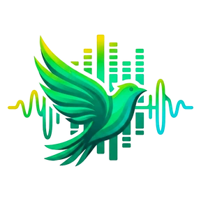
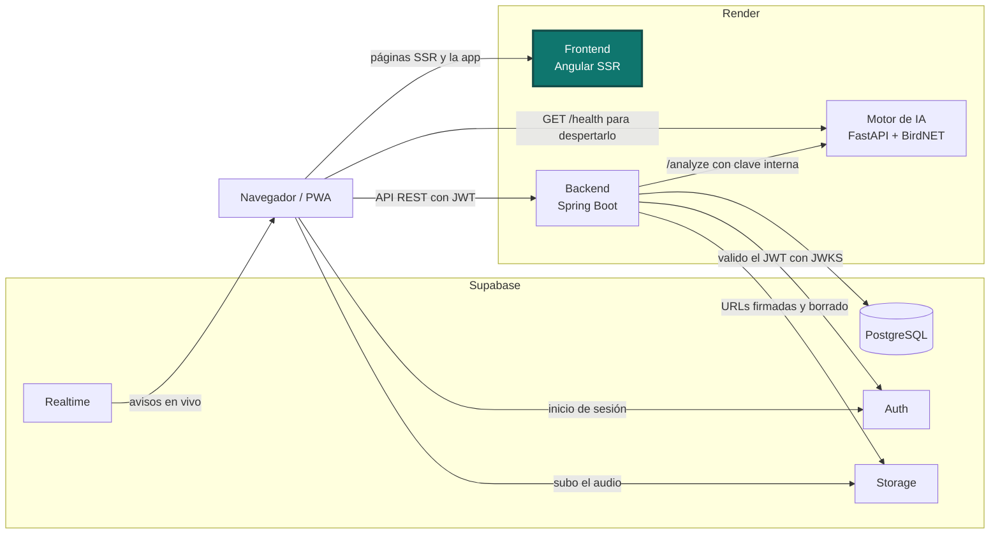
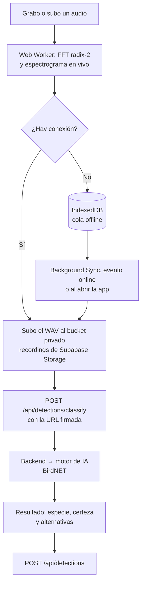

<p align="center">
  
</p>

<h1 align="center">AlaSonora · Frontend</h1>

<p align="center">
  Identifico aves por su canto: grabas o subes un audio, te digo qué especie es y la detección queda en un
  mapa compartido. Pruébalo en <a href="https://alasonora.com">alasonora.com</a>.
</p>

<p align="center">
  <a href="https://github.com/solartedaniers/AlaSonora-Frontend/actions/workflows/ci.yml"></a>
  <a href="https://angular.dev"></a>
  <a href="https://nodejs.org"></a>
  <a href="https://www.typescriptlang.org"></a>
  <a href="https://v3.tailwindcss.com"></a>
  <a href="https://supabase.com/docs/reference/javascript"></a>
  <a href="https://leafletjs.com"></a>
</p>

## Contenido

- [El proyecto](#el-proyecto)
- [Arquitectura](#arquitectura)
- [Identificación por foto: mejora futura](#identificación-por-foto-mejora-futura)
- [Tecnologías](#tecnologías)
- [Requisitos previos](#requisitos-previos)
- [Variables de entorno y configuración](#variables-de-entorno-y-configuración)
- [Correrlo en local](#correrlo-en-local)
- [Pruebas y build](#pruebas-y-build)
- [Flujo de una grabación](#flujo-de-una-grabación)
- [Renderizado y workers](#renderizado-y-workers)
- [Modo offline y "Grabaciones offline"](#modo-offline-y-grabaciones-offline)
- [Caché de navegación](#caché-de-navegación)
- [Eliminar mis grabaciones](#eliminar-mis-grabaciones)
- [Errores traducidos](#errores-traducidos)
- [Encendido del motor de IA](#encendido-del-motor-de-ia)
- [Despliegue en Render](#despliegue-en-render)
- [Estructura](#estructura)
- [Problemas comunes](#problemas-comunes)

## El proyecto

AlaSonora tiene tres repositorios:

| Parte | Repositorio | Papel |
|---|---|---|
| Frontend | **este repositorio** | PWA en Angular con SSR: grabación, espectrograma, mapa y modo offline |
| Backend | [AlaSonora-Backend](https://github.com/solartedaniers/AlaSonora-Backend) | API REST en Spring Boot: sesiones, base de datos, Storage y orquestación de la IA |
| Motor de IA | [AlaSonora-IA](https://github.com/solartedaniers/AlaSonora-IA) | Microservicio en FastAPI que identifica la especie con BirdNET |

Este repositorio es lo que ve el usuario. Construí una PWA instalable que graba el canto con el
micrófono, o acepta un archivo, y dibuja el espectrograma en vivo. Le envía el audio al backend para
identificar la especie y muestra el resultado, el historial y el mapa de la red. La sesión la manejo
con Supabase Auth, y la interfaz está en español e inglés, con tema claro y oscuro. Si grabas sin
señal en el campo, la grabación queda guardada y se envía sola cuando vuelve la conexión.

## Arquitectura

El recuadro resaltado es este repositorio.



## Identificación por foto: mejora futura

La función principal de AlaSonora es identificar aves por su canto con BirdNET, y está activa. La
identificación por foto la dejé como mejora futura y la apagué a propósito: es una decisión, no un
error. El motor ya tiene el endpoint `/classify-photo`, pero en producción está desactivado con
`PHOTO_CLASSIFICATION_ENABLED=false` en el motor y `photoIdentificationEnabled=false` en el frontend.
Lo hice porque el servidor gratis de Render tiene 512 MB de RAM: el audio usa unos 360 MB y con fotos
el proceso llegaría a unos 750 MB.

## Tecnologías

| Pieza | Versión |
|---|---|
| Node.js | 24 (`engines` en `package.json`; uso la 24.19.0) |
| npm | 11.12.1 |
| Angular (core, router, forms, service worker, platform-server) | 22.1.5 |
| Angular CLI, `@angular/build` y `@angular/ssr` | 22.1.7 |
| TypeScript | 6.0.3 |
| Express (servidor SSR) | 5.2.1 |
| Supabase JS | 2.116.0 |
| Tailwind CSS | 3.4.19 |
| Leaflet (mapa) | 1.9.4 |
| Karma + Jasmine (pruebas) | 6.4 y 5.6 |

## Requisitos previos

- **Node.js 24** y npm. Los verificas con `node -v` (`v24.x`) y `npm -v`.
- **Google Chrome** para correr las pruebas en modo headless. Si Karma no lo encuentra, define
  `CHROME_BIN` con la ruta del ejecutable.
- **El backend corriendo** en `http://localhost:8083` para iniciar sesión, clasificar o ver datos
  ([AlaSonora-Backend](https://github.com/solartedaniers/AlaSonora-Backend)).
- **El motor de IA corriendo** en `http://localhost:8000` si quieres clasificar audios
  ([AlaSonora-IA](https://github.com/solartedaniers/AlaSonora-IA)).

## Variables de entorno y configuración

Las únicas variables de entorno las lee `npm run build`, del sistema o de un `.env` (el ejemplo está
en `.env.example`). El build nunca falla si faltan.

| Variable | Para qué sirve | Obligatoria | Ejemplo |
|---|---|---|---|
| `SITE_URL` | Origen público. Con ella genero el link canonical, `og:url`, `og:image`, `robots.txt` y `sitemap.xml` | No (sin ella el build los omite) | `https://alasonora.com` |
| `DEMO_ACCOUNT_EMAIL` | Correo de la cuenta de ejemplo que el login muestra como placeholder | No | `demo@example.org` |
| `DEMO_ACCOUNT_PASSWORD` | Contraseña de esa cuenta de ejemplo | No | `<contraseña de la cuenta demo>` |
| `PORT` | Puerto del servidor SSR al correrlo (no lo lee el build). Render lo inyecta | No (`4000`) | `4000` |

Las URLs, los tiempos y los límites de la app no son variables de entorno: viven en
`src/environments/environment.ts` (producción) y `environment.development.ts` (desarrollo). Los dos
archivos solo cambian en `production`, `apiBaseUrl` y `aiEngine.healthUrl`.

| Clave | Para qué sirve | Valor |
|---|---|---|
| `apiBaseUrl` | URL del backend | `https://alasonora-backend.onrender.com/api` (local: `http://localhost:8083/api`) |
| `supabaseUrl`, `supabasePublishableKey` | Proyecto de Supabase. La clave *publishable* es pública por diseño y la protege RLS | la del proyecto |
| `photoIdentificationEnabled` | Muestra la identificación por foto | `false` |
| `aiEngine.healthUrl` | `/health` público del motor, para despertarlo desde el navegador | `https://alasonora-ai-engine.onrender.com/health` (local: `http://localhost:8000/health`) |
| `aiEngine.*` (resto) | Cada cuánto pregunto el estado del motor y cuánto espero a que encienda | `statusPollMs: 3000`, `browserWakeIntervalMs: 60000`… |
| `audioUpload` | Tope y formatos de audio, los mismos que el backend | `10485760` bytes; `wav`, `flac`, `mp3` |
| `navigationCache.maxAgeMs` | Vigencia del caché al cambiar de pantalla | `300000` (5 min) |
| `offlineRecordingsLog` | Cuántas grabaciones offline ya enviadas recuerdo y por cuántos días | `maxEntries: 20`, `maxAgeDays: 30` |
| `username` | Reglas del nombre de usuario, las mismas que `profile.username.*` del backend | 3 a 20 letras y números |
| `toastMs` | Duración de los avisos breves | `3000` |

## Correrlo en local

```bash
git clone https://github.com/solartedaniers/AlaSonora-Frontend.git
cd AlaSonora-Frontend
npm ci
npm start
```

`npm start` corre `ng serve` en `http://localhost:4200` con `environment.development.ts`, que apunta
al backend en `http://localhost:8083/api` y al motor en `http://localhost:8000/health`. En desarrollo
el Service Worker está apagado.

Para probar el build de producción con SSR:

```bash
cp .env.example .env          # opcional: SITE_URL y la cuenta demo
npm run build
npm run serve:ssr:frontend    # http://localhost:4000
```

Este build usa `environment.ts`, que apunta a los servicios de producción en Render.

### Conectarlo con los otros dos servicios

1. Arranco el motor de IA: `uvicorn app.main:app --host 0.0.0.0 --port 8000`.
2. Arranco el backend con `AI_ENGINE_BASE_URL=http://localhost:8000` en su `.env`:
   `./mvnw spring-boot:run`.
3. Arranco este frontend con `npm start`. El backend ya permite por CORS los orígenes
   `http://localhost:4200` y `http://localhost:4000`.

Los correos de Supabase Auth (confirmar cuenta y restablecer contraseña) vuelven al origen actual del
navegador. Para que funcionen en local, ese origen debe estar en las Redirect URLs de Supabase.

## Pruebas y build

```bash
npx ng test --watch=false --browsers=ChromeHeadless   # pruebas unitarias
SITE_URL=https://alasonora.com npm run build          # build de producción con SSR y prerender
```

Antes del build, `prebuild` (`scripts/material-icons.mjs`) revisa que todos los íconos de Material
Symbols que uso estén en la lista central. Si falta alguno, el build se detiene. Después,
`scripts/seo-files.mjs` escribe `robots.txt` y `sitemap.xml` a partir de `seo/`. El workflow
`.github/workflows/ci.yml` corre `npm ci`, el build y las pruebas en cada push a `main` y en cada pull
request.

## Flujo de una grabación



## Renderizado y workers

**Patrones de renderizado** (la elección por ruta está en `src/app/app.routes.server.ts`):

| Patrón | Rutas |
|---|---|
| SSG (prerender en el build) | `/`, `/login`, `/register`, `/forgot-password` |
| SSR con caché ISR (stale-while-revalidate, 60 s) | `/map`, con la caché en `src/server.ts` |
| CSR | Rutas privadas (`/dashboard`, `/record`, `/history`, `/profile`, `/admin`…) y `/reset-password` |
| Hidratación incremental | `@defer (hydrate on viewport)` y `@defer (hydrate never)` en la landing, con replay de eventos (`withEventReplay`) |

**Workers:**

- **Web Worker** (`src/app/workers/audio-processing.worker.ts`): calcula el espectro del audio fuera
  del hilo principal con `SpectrumAnalyzer`, una FFT radix-2 iterativa de O(n log n) con ventana de
  Hann. Solo si un trozo no mide una potencia de 2 (el último, más corto) uso la DFT directa, que da la
  misma salida. El espectrograma se pinta en `requestAnimationFrame` con lo que llega del worker.
- **Shared Worker** (`src/app/workers/sync.worker.ts`): una sola instancia para todas las pestañas.
  Si una detección nueva aparece en una pestaña, aparece al instante en las demás. También cuenta las
  pestañas abiertas.
- **Service Worker** (`public/sw.js`, que importa `ngsw-worker.js` de Angular y usa `ngsw-config.json`):
  guarda en caché el app shell y los recursos, y añade el manejador de Background Sync.

## Modo offline y "Grabaciones offline"

Si grabas sin conexión, la grabación queda en IndexedDB (`OfflineStorageService`) y
`PendingRecordingsSyncService` la envía sola: la sube, la clasifica y la guarda. Lo hace cuando el
Service Worker lanza `sync` (Chromium), con el evento `online` (Firefox y Safari) o al abrir de nuevo
la app. Sin conexión, grabar sigue habilitado aunque el motor esté apagado, porque el audio queda en
cola.

En Historial, la sección **Grabaciones offline** muestra lo que grabaste sin conexión, leído desde el
dispositivo, así que se ve aunque el historial del backend no cargue:

| Estado | Qué significa |
|---|---|
| Pendiente de subir | Sigue en la cola de IndexedDB. Con conexión, el botón "Reintentar ahora" la envía al momento |
| Sincronizada | Ya se guardó como detección; tiene un enlace a ella |
| No se pudo identificar | El motor rechazó el audio, así que no se guardó como detección |

El resultado de cada grabación ya enviada queda en otra base de IndexedDB (`alasonora-offline-log`,
`OfflineRecordingsLogService`), sin el audio, con el tope de `offlineRecordingsLog`. Lo borro al
cerrar sesión.

## Caché de navegación

`NavigationCacheService` recuerda en memoria la última respuesta del historial, las estadísticas, el
dashboard y el feed del mapa (stale-while-revalidate). Al volver a una pantalla muestro esos datos al
instante y los actualizo en segundo plano; la animación de carga solo sale la primera vez, o si
pasaron más de `navigationCache.maxAgeMs`. Si la actualización falla, los datos guardados se quedan
en pantalla.

- Lo invalido al guardar o sincronizar una detección, al subir la foto del observador, al borrar una
  detección (propia o desde el admin) y al editar el perfil.
- Lo borro al cerrar sesión o al cambiar de cuenta, y nunca sirvo datos de otro usuario.
- Solo vive en la memoria del navegador: nunca en `localStorage` ni en SSR.
- En el dashboard, el espectrograma espera a las URLs de audio recién firmadas, porque las guardadas
  vencen a los 120 s.

## Eliminar mis grabaciones

Cada grabación de Historial, en la vista de láminas y en la de lista, tiene un botón con el ícono de
basura al pie, junto al badge de certeza. Al pulsarlo abro un diálogo propio de la app
(`ConfirmDialogComponent`, sobre `<dialog>` nativo con `showModal()`): atrapa el foco, Escape lo
cierra y avisa que, si la grabación era pública, también se quita del mapa público, y que no se puede
deshacer.

Al aceptar llamo a `DELETE /api/detections/{id}`, quito la grabación de la lista sin recargar,
invalido el caché de navegación, borro su fila de "Grabaciones offline" y muestro el aviso
"Grabación eliminada". Si falla, el error aparece en el diálogo y la grabación se queda. Mientras
borra, los botones quedan deshabilitados; sin conexión, el botón se deshabilita con la explicación.

## Errores traducidos

El backend responde cada error con un `errorCode` estable y el texto para el usuario vive en
`public/i18n/es.json` y `en.json`. Así un mensaje cambia o se traduce sin tocar el backend:

| `errorCode` | Dónde lo uso |
|---|---|
| `AUDIO_TOO_LARGE`, `AUDIO_UNSUPPORTED` | Grabar: los mismos textos que la validación local del archivo |
| `AUDIO_TOO_NOISY`, `NO_BIRD_SIGNAL`, `AUDIO_REJECTED` | Grabar: el motor rechazó el audio por calidad |
| `NO_SPECIES_IDENTIFIED` | Grabar: BirdNET no encontró ninguna especie |
| `AI_ENGINE_UNAVAILABLE` | Grabar: el motor está dormido o caído |
| `AI_ENGINE_BUSY` | Grabar: el motor está encendido pero el backend tiene su pool lleno, así que no lo trato como dormido |
| `USERNAME_TAKEN`, `USERNAME_INVALID` | Perfil y panel de administración |

## Encendido del motor de IA

El motor duerme en Render tras 15 minutos sin uso, y no uso keep-alive.

- **Cuándo lo despierto**: cuando el usuario inicia o restaura sesión, entra a Grabar, pulsa
  "Encender de nuevo" o una clasificación lo encuentra dormido, `AiEngineStatusService` le pregunta
  al backend.
- **Desde el navegador**: `AiEngineBrowserWakeUpService` hace un `GET` silencioso al `/health`
  público del motor (`no-cors`, `no-store`, sin cookies, fuera del Service Worker). Hace falta porque
  Render no deja que el backend lo despierte.
- **Mientras enciende**: lo repito cada `aiEngine.browserWakeIntervalMs` (60 s) solo mientras dice
  "encendiendo…". Grabar y subir siguen bloqueados hasta que se pone en verde.

## Despliegue en Render

| Ajuste | Valor |
|---|---|
| Tipo de servicio | Web Service, runtime Node |
| Root Directory | *(vacío)* |
| Build Command | `npm ci && npm run build` |
| Start Command | `npm run serve:ssr:frontend` |
| Variables | `SITE_URL=https://alasonora.com` y, opcionales, `DEMO_ACCOUNT_EMAIL` y `DEMO_ACCOUNT_PASSWORD` |

El frontend no tiene un endpoint de salud dedicado. Si configuras un Health Check Path, `/` sirve: es
una página prerenderizada que responde 200 sin depender del backend. El dominio propio es
https://alasonora.com, y la app también responde en https://alasonora-frontend.onrender.com.

## Estructura

```
src/
  app/
    core/        Servicios, guards, interceptor de autenticación, modelos y validadores
    features/    Pantallas: landing, auth, dashboard, recording, result, history, map, profile, admin…
    shared/      Componentes (diálogo de confirmación, toast…), pipes, marca (logo) y sonograma
    workers/     Web Worker del audio (FFT) y Shared Worker de sincronización
    app.routes.ts, app.routes.server.ts, app.config.ts
  environments/  URLs, tiempos y límites de desarrollo y producción
  server.ts      Servidor Express de SSR con la caché ISR
public/          Íconos, imágenes, i18n (es.json, en.json), manifest y sw.js
scripts/         Build con variables, verificación de íconos y archivos SEO
seo/             Reglas de robots.txt y rutas del sitemap
ngsw-config.json Caché del Service Worker
```

## Problemas comunes

| Síntoma | Causa | Solución |
|---|---|---|
| `npm ci` avisa de `engines` o falla con otra versión de Node | El proyecto pide Node 24 | Instala Node 24 y revisa con `node -v` |
| Las pruebas no arrancan: `No binary for ChromeHeadless browser` | Karma no encuentra Chrome | Instala Chrome o define `CHROME_BIN` |
| El build se detiene en `material icons` | Usaste un ícono que no está en `src/app/theme/material-icons.json` | Corre `npm run prebuild` para ver cuál, agrégalo a la lista y corre `npm run icons:subset` para regenerar la fuente |
| El build avisa `SITE_URL is empty or invalid` | Falta `SITE_URL` | Es solo un aviso. Ponla para tener canonical, `og:image` y sitemap |
| Las peticiones al backend fallan por CORS en local | El origen no está permitido en el backend | Usa `localhost:4200` o `4000`, o agrégalo a `app.cors.allowed-origins` |
| El indicador del motor se queda en "encendiendo…" en local | El motor no corre en `localhost:8000` | Arranca AlaSonora-IA o revisa `aiEngine.healthUrl` en `environment.development.ts` |
| La PWA instalada sigue mostrando una versión vieja | El Service Worker sirve la caché anterior | Acepta el aviso de actualización o recarga dos veces |
| El enlace del correo de Supabase no vuelve a la app | El origen no está en las Redirect URLs de Supabase | Agrega el origen (local, onrender o el dominio) en Supabase Auth |
